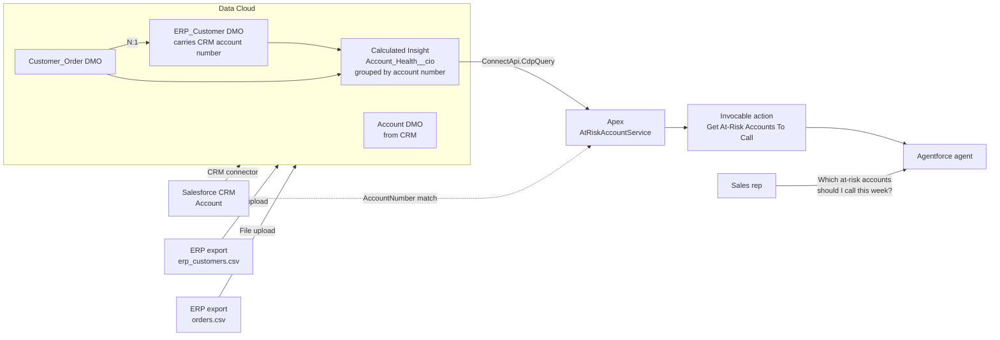
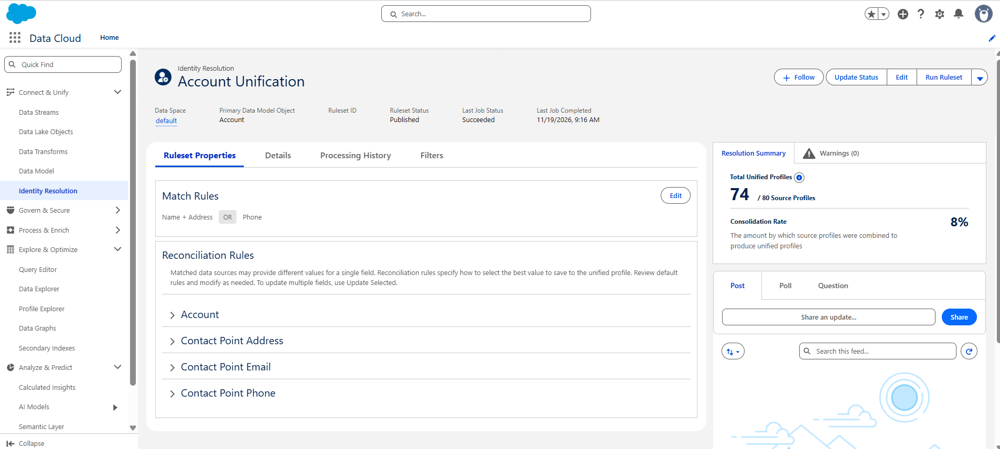
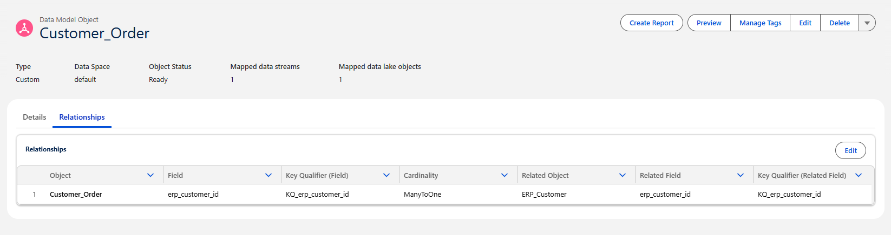
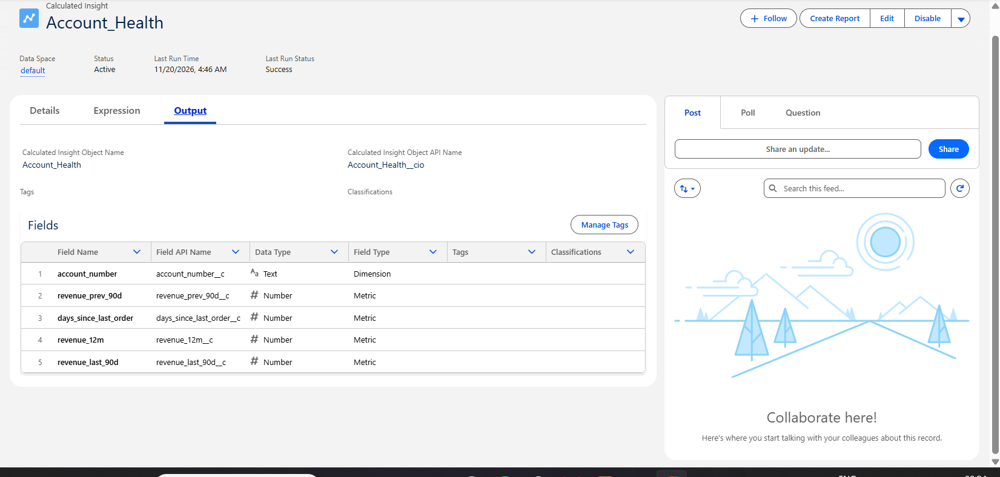
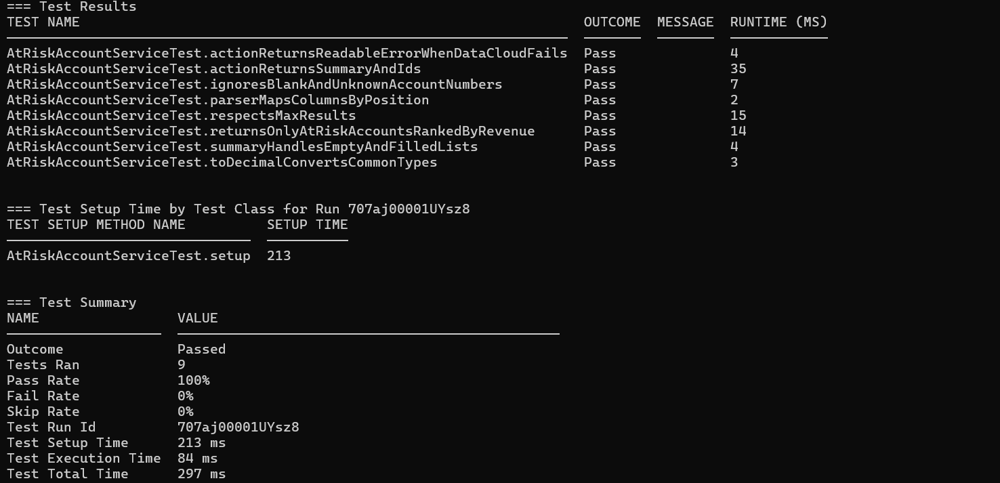
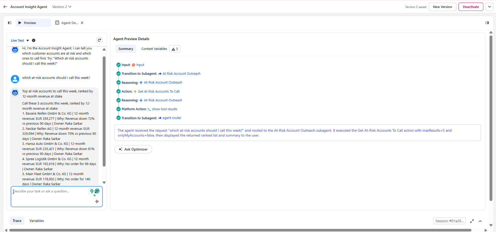

# Unified Customer 360 + Account Insight Agent

**Salesforce Data Cloud (Data 360) · Agentforce · Apex**

A sales rep asks the agent: **"Which at-risk accounts should I call this week?"**
The agent answers with a ranked list, the reason each account is at risk, and the revenue at stake,
using order history that does **not** live in Salesforce CRM.

> 🎥 Demo video: _add link here_
>
> **Status:** working end to end in a Salesforce Developer Edition org (Nov 2026). The agent returns the
> 16 accounts that the sample data was designed to put at risk, with no false alarms.

---

## The business problem

Account data sits in the CRM. Order data sits in the ERP. Customer names don't match between the two
("Sued Reifen GmbH" vs "SUED REIFEN GMBH"), so nobody has one view of an account's buying behaviour.
The ERP does store the CRM account number, which is the key this project uses to join them.
Reps find out an account went quiet months too late.

## What this project does

1. **Ingests 2 sources** into Data Cloud: CRM Accounts + an ERP export (customers and orders as CSV).
2. **Identity resolution** on Account (CRM + ERP, rules: fuzzy name + city/country, OR phone) is
   configured, but merged only 8% of records on this sample data. The insight therefore links ERP
   orders to CRM accounts through an **exact account-number match** (see "Design decisions").
3. **Calculated insight** `Account_Health` computes per account: 12-month revenue,
   revenue in the last 90 days vs the 90 days before, and days since the last order.
4. **Apex action** applies a clear, tested risk rule and ranks accounts by revenue at stake.
5. **Agentforce agent** calls the action and answers in plain language.

## Architecture



## Risk rule

An account is **at risk** if either is true:

| Signal | Rule |
|---|---|
| Gone quiet | No order for **60+ days** |
| Declining | Revenue in last 90 days is **40%+ lower** than the 90 days before |

At-risk accounts are ranked by **12-month revenue** (most money at stake first).
Thresholds are constants in `AtRiskAccountService.cls`.

## Design decisions

- **Exact key match over fuzzy identity resolution.** An Account ruleset (fuzzy name + city +
  country, OR phone + name) consolidated only 8% of the 80 source records: the fuzzy name match
  missed variants such as "Sued Reifen GmbH" vs "SUED REIFEN-HANDEL GMBH", and the rule editor
  requires an Account field in every rule, so phone could not be used alone. Because the ERP
  customer master carries the CRM account number, the insight joins on that key instead. When a
  shared key exists, an exact match is more reliable than fuzzy matching. Fuzzy identity resolution
  is for when no shared key exists.
- **Numbers in Data Cloud, rule in Apex.** The insight produces plain metrics; the "at risk" decision
  lives in version-controlled, unit-tested code that is easy to explain and change.
- **Testable Data Cloud access.** `IDataCloudQuery` wraps `ConnectApi.CdpQuery.queryAnsiSqlV2`, so tests
  use a fake client. All Data Cloud object names are in one class (`DataCloudNames`).
- **Agent can't make up numbers.** Topic instructions force the agent to use the action; the action
  returns a ready-to-read summary plus account Ids.
- **Sharing respected.** Apex runs `with sharing`, so reps only see accounts they have access to.
- **Synthetic data only.** `scripts/generate_sample_data.py` creates realistic but fake data, plus an
  answer key to verify the agent's output.

## Screenshots

| | |
|---|---|
| Data streams |  |
| Identity resolution ruleset |  |
| Data model (Customer_Order → ERP_Customer) |  |
| Calculated insight |  |
| Apex tests + coverage |  |
| Agent subagent + action |  |
| Agent answering |  |

## Repo structure

```
force-app/main/default/
  classes/
    AtRiskAccountsAction.cls      # @InvocableMethod used by Agentforce
    AtRiskAccountService.cls      # risk rule + ranking
    DataCloudQueryService.cls     # Data Cloud Query API wrapper
    IDataCloudQuery.cls           # interface (for testing)
    DataCloudNames.cls            # all Data Cloud API names in one place
    AtRiskAccountServiceTest.cls  # unit tests
  permissionsets/Account_Insight_Agent_Access.permissionset-meta.xml
data/                             # generated sample data
docs/
  BUILD_GUIDE.md                  # full step-by-step setup
  datacloud/                      # calculated insight SQL + check queries
  screenshots/
scripts/
  generate_sample_data.py
  run_action.apex                 # smoke test from the CLI
```

## Run it yourself

Full guide: **[docs/BUILD_GUIDE.md](docs/BUILD_GUIDE.md)**. Short version:

```bash
sf org login web --alias demo --set-default
python3 scripts/generate_sample_data.py
sf data import bulk --sobject Account --file data/crm_accounts.csv --line-ending CRLF --wait 10
# Data Cloud setup in the UI: streams → data model → calculated insight (see guide)
# then build the agent in Agentforce Builder (see guide, Step 8)
sf project deploy start --source-dir force-app
sf apex run test --test-level RunLocalTests --code-coverage --result-format human --wait 10
sf org assign permset --name Account_Insight_Agent_Access
sf apex run --file scripts/run_action.apex
```

## Limitations and next steps

- Data Cloud configuration is done in the UI and documented here, not deployed as code (next: package it as a Data Kit).
- Risk rule is rule-based, not ML. Next: replace with an Einstein / external churn model score.
- Next action for the agent: create a follow-up Task for the rep on each at-risk account.
- Built with the Agentforce Builder as of Nov 2026 (topics are called "Subagents"). Salesforce
  renames menus often; the build guide lists what each step looked like at the time.
- **Lessons learned** while building (mapping gaps, match rule logic, Data Cloud SQL dialect) are
  in the troubleshooting table at the end of [docs/BUILD_GUIDE.md](docs/BUILD_GUIDE.md).

## License

MIT
